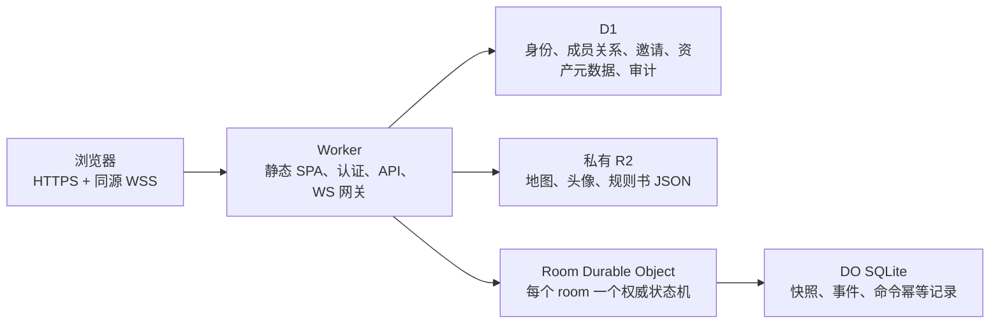

# Cloudflare 全栈架构与权限模型

## 目标与边界

应用只有一个公开入口：`https://app.example.com`。静态 React 应用、HTTP API 和 WebSocket 都在这个同源 URL 下，因而玩家无需 LAN、端口映射、IP 地址或手动输入 WebSocket 地址。



- Worker 是唯一公网后端；它验证 HttpOnly Cookie、请求 Origin 和 D1 权限，然后才把可信身份转给房间 DO。
- D1 是控制面：长期身份、桌团、战役、房间、成员、邀请、R2 元数据和审计。它不承担高频 token 移动。
- 一个 `room:<roomId>` 对应一个 Durable Object。DO 串行化命令，先写 DO SQLite，再广播。它使用 hibernatable WebSocket attachment，因此重启/休眠后仍能恢复已验证的成员上下文。
- R2 全部保持私有。应用仅通过受权限保护的 `/api/rooms/:slug/assets/:assetId` 读取房间素材，浏览器永远拿不到裸 object key 或公共 bucket URL。

Cloudflare 的 Static Assets 提供 SPA；`/api/*` 被 `run_worker_first` 保留给 Worker，避免 SPA fallback 吞掉 API 或 WebSocket upgrade。

## 数据模型

`worker/migrations/0001_control_plane.sql` 建立以下分层：

```text
Workspace（桌团 / 租户边界）
└─ Campaign（长期资料与成员）
   ├─ Scene template（可复用场景）
   ├─ Party（角色 roster，不是权限边界）
   └─ Room（一次在线会话 / 分享网址）
      └─ Room Durable Object（实时棋盘、token、先攻、雾、事件）
```

| 数据 | 保存位置 | 原因 |
| --- | --- | --- |
| 用户、访客会话、OAuth 关联 | D1 | 可审计、可撤销、跨设备 |
| 桌团、战役、成员、角色、队伍 | D1 | 稳定关系与租户隔离 |
| 房间 slug、成员、邀请、权限 epoch | D1 | 连接前的权限判定 |
| 当前棋盘、先攻、操作序号、命令回执 | 每房间 DO SQLite | 单写者、低延迟、断线恢复 |
| 地图、头像、附件、规则书与跑团模板 | 私有 R2 | 二进制对象不进入 SQL 行 |

`party_members.party_role` 只负责 roster 的“队长/成员”显示与角色组织；它永远不会自动变成 DM 或绕过 room membership。真正的最后授权边界是 `room_members`。

迁移中的兼容层把当前棋盘的多场景列表留在 room snapshot 中，保证现有客户端可用；D1 的 `scenes` / `scene_favorites` 表已预留为长期可复用模板与发布版本。将 live scene 发布成 template 是下一次数据迁移，而不是把高频 token/雾操作写进 D1。

## 权限策略

固定角色比任意自定义 ACL 更容易审计；UI 隐藏按钮只是辅助，每个 HTTP 和 WebSocket 命令都在服务端再次判定。

| 能力 | Workspace owner / room host | DM | Assistant DM | Player | Spectator |
| --- | ---: | ---: | ---: | ---: | ---: |
| 管理桌团、转让所有权 | ✓ |  |  |  |  |
| 创建/撤销玩家邀请 | ✓ | ✓ | ✓ |  |  |
| 编辑地图、怪物、雾、先攻、场景 | ✓ | ✓ | ✓ |  |  |
| 上传地图/通用 token | ✓ | ✓ | ✓ |  |  |
| 上传并编辑自己的头像 | ✓ | ✓ | ✓ | ✓ |  |
| 移动自己的服务器绑定角色 |  |  |  | ✓ |  |
| 只读公开投影 | ✓ | ✓ | ✓ | ✓ | ✓ |

当前实现中 `host`、`dm`、`assistant_dm` 都映射为旧棋盘 UI 的 `dm`；`spectator` 使用玩家投影但没有写操作。邀请只能授予 `player` 或 `spectator`，永远不能授予 owner/DM。

访客是受服务器控制的正式 `users` 行：首次访问生成 256-bit 随机会话令牌，D1 仅保存 SHA-256，浏览器保存 `Secure; HttpOnly; SameSite=Lax` Cookie。以后可通过 `identity_links` 把访客绑定到 OAuth/OIDC，而不丢失其角色和历史。

## 房间、邀请与实时协议

1. Host 创建房间：Worker 原子创建 workspace、campaign、room 和 host membership，然后初始化 `room:<id>` DO。
2. Host 创建邀请：默认生成一个永久、可重复使用的玩家邀请码；D1 同时保存规范化邀请码和摘要。显式提供 `maxUses` 的 API 调用仍可生成有限次数、7 天到期的临时邀请。
3. 分享链接：`/r/<slug>#invite=<code>`。fragment 不会出现在 HTTP request 或 Referer；客户端兑换成功后立即清除 fragment。
4. 兑换：D1 条件更新 `used_count`，创建 `room_members` 与 `invite_redemptions`。未兑换用户访问 room 返回泛化 404，不能枚举房间。
5. WebSocket：Worker 从 Cookie + D1 派生 `userId/memberId/role/accessEpoch`，仅以内部 header 转给 DO。浏览器 payload 中没有角色、DM token、sessionId 或可信 userId。

房间 DO 的初始兼容协议仍接受现有前端 `{ type: 'op', ops }`，但所有 op 都经过服务端 schema/范围校验和权限归一化：

- Player 只能移动自己的服务器绑定 token、改自己的显示信息、提交自己的先攻；不能提交任意 `sessionId` 或修改怪物 HP。
- DM 命令会生成/清洗资源 ID；地图只能引用当前房间的私有 asset URL。
- 每命令含有可选 client command ID，DO 用 `(member_id, command_id)` 去重；状态、事件、回执在同一 DO SQLite transaction 落盘后才广播。
- 每连接有最大帧大小、单帧 op 数量和每分钟命令预算。错误/越权命令不会修改状态。

后续成员移除接口应在 D1 把成员标记 `removed`、递增 `access_epoch`，并调用 DO 的 `disconnect-member` 内部操作关闭该成员现有 socket；重连始终重新查 D1。

## 数据投影与迷雾

DM 收到完整房间状态。Player/Spectator 投影会去掉敌人库和 DM 的 NPC 档案，并将其他玩家的稳定身份 ID 置空；DO 不再像旧架构那样把一份完整原始状态无差别广播给所有 WebSocket。

NPC 档案是战役级数据，跨场景保存名称、别名、身份、位置、状态、Markdown 备注和来源文件。浏览器只负责解析本地 Markdown；最终 `upsertNpc` 仍由 Worker 限制字段长度、档案数量和角色权限，再写入房间 DO。NPC Token 使用独立 `npc` 类型和档案关联 ID，因此不会进入敌人栏、怪物 HP 补全或怪物自动先攻。

DM 的迷雾擦除采用地图原始坐标中的矩形区域：按下确定起点、拖动预览、松开提交 `revealFogRect`。矩形使用连续像素坐标，不吸附旧的 50px 迷雾格；客户端将旧格子与新矩形合并投影，因此历史房间和备份保持兼容。Worker 校验区域边界和数量后在 DO 事务中持久化并广播，地图校准缩放只影响渲染倍率，不改变已擦除区域的相对位置。

不过“整图原图已经发送到浏览器”时，CSS/Konva 雾只能是视觉效果，不能保密。这一版明确把它称为 `cosmetic fog`。若游戏需要真正隐藏地图，下一阶段必须把地图切片/派生，并仅按可见格向玩家签发 tile；不要把 CSS 遮罩当作安全功能。

## R2 与资料库

- 房间上传：Worker 目前直接校验并写入最多 10 MiB 的 JPEG/PNG/WebP/AVIF，检查文件签名，并返回受鉴权的相对 URL。更大地图应升级为短期、单对象的 R2 直传 intent。
- 规则书：`npm run data:update` 在 Node/CI 下载并生成索引；`npm run data:publish` 将 `index.json` 和各 book JSON 上传到 `REFERENCE_DATA`。Worker 搜索索引并按需读取一个 book，再返回单个条目。
- 跑团模板：`output/room-templates/index.json` 是模板目录，每个模板在 `room-templates/<templateId>/manifest.json` 保存只读场景与 NPC 快照，地图使用带内容摘要的对象 ID。创建房间前 Worker 验证 manifest，并在对应 Room DO 中生成新的 campaign/scene ID；房间之间不共享可变状态。模板地图通过 `/api/rooms/:slug/template-assets/:templateId/:assetId` 返回，仍需 D1 房间成员权限。
- 旧 `sharp` 图像裁剪没有进入 Worker；规则书 token 无 R2 缓存时会返回无害 SVG 占位图。

## 生产域名与公开配置

- `wrangler.jsonc` 不保存 Custom Domain。`scripts/deploy-production.mjs` 从 `PUBLIC_SITE_DOMAIN` 读取单个 hostname，并以 Wrangler `--domain` 绑定它；Cloudflare 负责该 hostname 的 DNS 和证书。目标 zone 必须在同一个 account，且 hostname 不能有冲突 CNAME。`workers.dev` 保持关闭。
- 仓库不含自动部署的 GitHub Actions。首次部署需要本地 bootstrap（先 deploy 创建资源、migration、再 deploy），避免公开一个尚未有 schema 的控制面；后续发布也从已登录目标 account 的终端执行。
- `PUBLIC_SITE_DOMAIN`、`PUBLIC_ICP_FILING` 和 `PUBLIC_PSB_FILING` 是部署环境变量，不是 secrets。前者只供部署脚本绑定 Custom Domain；Worker 的 `/api/public-config` 只公开后两个非空、长度受限的备案字符串。客户端仅在备案变量存在时渲染相应链接，因此同一个前端产物可用于有或无备案信息的环境。

## 部署与运维

生产配置在 `wrangler.jsonc`：使用 declarative `exports` 声明 SQLite DO，不使用 legacy DO migrations；D1 migration 仍必须显式运行 `wrangler d1 migrations apply`。

```bash
npm run build
npx wrangler deploy
npm run db:migrate:remote
npx wrangler deploy
```

不要把真实 OAuth client secret、R2 S3 key 或部署凭据放入代码、`.dev.vars` 或 D1。未来 OAuth secret 用 `wrangler secret put`；运行日志与审计事件不得记录 Cookie、邀请原文或上传内容。

本地 `wrangler dev` 使用 `.wrangler/state` 以让 D1/R2/DO 数据跨重启保留。当前 Wrangler 本地 workerd 可能暂时落后 `compatibility_date` 一两天；项目配置仍保持当前生产日期，若本地 runtime 报日期不支持，可仅在开发命令增加其提示的较早 `--compatibility-date`，不要回退生产配置。
