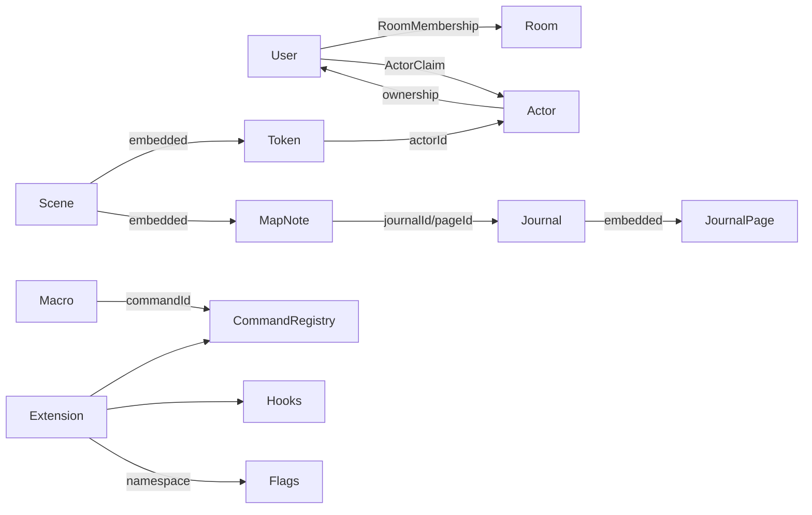

# 面团优先的 FVTT 式文档架构

## 目标与边界

本项目不是完整复刻 Foundry VTT。它服务同桌跑团，继续优先保证地图、Token、先攻、资料速查和主持人操作速度；不把语音、视频、聊天保密、逐客户端动态视野等网团能力带入核心复杂度。

本架构借用 Foundry 最稳定的四条边界：

1. 战役内容是独立 `Document`，场景中的对象只引用文档。
2. 房间角色决定系统能力，文档 Ownership 决定具体内容的查看与编辑。
3. Journal 包含 Page，Scene 包含 Token/MapNote；嵌入对象不反向拥有父文档。
4. 扩展通过注册表、Hook 和命名空间 flags 接入，不直接修改核心状态结构。

## 已落地能力

当前三个优先级已经按同一文档模型实现，而不是分别堆叠互不相通的面板：

| 优先级 | 已实现 |
|---|---|
| 第一优先级 | Actor Ownership 与认领/释放、Journal/Page 权限、地图标记、声明式宏与 10 格快捷栏 |
| 第二优先级 | 可停靠/浮动/缩放的工作区、统一 Placeable 选择与框选、50 步撤销/重做、完整场景配置、View/Activate 分离、按选择单位建立 Encounter |
| 第三优先级 | Actor 角色卡、物品与状态效果、回合持续时间、掷骰与行动日志、随机表/播放列表/遭遇预设、素材库、用户设置、快捷键与命令面板、扩展注册表和生命周期 Hook |

地图测距与区域模板按产品边界明确不实现；来源地图没有可靠物理比例时，显示精确距离会误导主持人。

## 领域关系



## 文档与嵌入对象

### 战役级文档

- `Actor`：角色、NPC、怪物的唯一资料来源。`system` 交给规则系统解释，核心只管理身份、权限和原型 Token。
- `JournalEntry`：日志、手册和资料册目录项；包含有序的 `JournalPage`。
- `Macro`：保存一个已注册命令的 ID 与 JSON 参数，不保存任意 JavaScript。
- `Folder`：按文档类型建立树；Actor、Journal、Macro 各自有独立根目录。

所有文档共享：`id / campaignId / name / folderId / sort / ownership / flags / createdBy / timestamps`。

### 场景嵌入对象

- `Token`：保存坐标、场景覆盖值和 `actorId`。放置时继承 Actor 的原型 Token；在当前场景编辑 Actor 后同步名称、头像与颜色，HP 等场景差异继续作为 Token delta 保存。
- `MapNote`：保存坐标、图标、标签与 `journalId/pageId`。正文只存在 Journal Page 中。
- `Wall/Fog`：仍是 Scene 嵌入数据，不属于文档目录。

## 权限与角色认领

权限等级固定为：

| 等级 | 能力 |
|---|---|
| `none` | 不出现在目录或地图标记中 |
| `limited` | 看见目录项/标记和安全摘要，不能打开全文 |
| `observer` | 打开并阅读，不可修改或控制 Actor |
| `owner` | 阅读、编辑；Actor Owner 可以控制其 Token |

求值顺序：

1. `host/dm/assistant_dm` 固定为 Owner。
2. 平台所有者审计身份固定为 Observer，不能编辑。
3. 使用 `ownership.users[userId]`；没有覆盖时使用 `ownership.default`。

`ActorClaim` 与 Ownership 分离：

- Claim 表示该房间中“此用户当前扮演哪个 Actor”。
- Claim 要求用户已经拥有 Actor Owner；Claim 本身不修改 Ownership，释放后也不会意外撤销主持人授予的权限。
- 一个 Actor 在一个房间只能有一个控制者；一个玩家默认只能有一个主 Actor。
- Token 不保存用户 ID。重连、换设备和场景切换都通过 Claim 找回 Actor，再定位其 Token。

## Journal、手册与地图标记

`JournalEntry` 是目录容器，`JournalPage` 支持 `markdown / image / pdf / handout`。Page 继承 Journal Ownership，不另建一套容易漂移的权限。

地图标记有三种可见策略：

- `inherit`：跟随 Journal 权限。
- `gm`：仅主持人；用于陷阱、幕后提醒。
- `all`：所有入场者可见标记，但能否打开全文仍由 Journal 权限决定。

拖放 Journal/Page 到地图只创建引用。删除标记不删除 Journal；删除 Journal 时关联标记软删除。正文、图片或 PDF 更新后所有标记立即指向新版本。

## 宏与扩展

### 为什么不保存脚本宏

本项目运行在 Cloudflare Worker 和浏览器中。允许房间数据携带任意 JavaScript 会破坏 CSP、权限审计和可重复部署。因此宏是声明式命令：

```json
{
  "commandId": "core.dice.roll",
  "args": { "formula": "1d20+5" }
}
```

命令由已安装扩展注册；命令声明输入 schema、所需能力和执行位置。所有状态修改最终仍经过现有 HTTP/WS 服务端授权。

### 扩展清单

```ts
interface TabletopExtension {
  id: string;
  version: string;
  requiresCore: string;
  register(host: ExtensionHost): void;
}
```

`ExtensionHost` 只暴露稳定槽位：

- `commands.register`
- `hooks.on / hooks.emit`
- `documents.registerSubtype`
- `ui.registerSidebarTab`
- `ui.registerDocumentAction`
- `ui.registerTokenAction`

扩展数据必须放入 `flags[extensionId]`。扩展只能在构建/部署阶段安装，房间内只负责启停和配置；这比运行时下载脚本更适合当前私有 Cloudflare 部署。

### 生命周期 Hook

- `ready`
- `documentCreated / documentUpdated / documentDeleted`
- `actorClaimed / actorReleased`
- `sceneActivated`
- `tokenCreated / tokenMoved / tokenDeleted`
- `encounterStarted / turnChanged / encounterEnded`
- `macroExecuted`

文档 Hook 在成功 HTTP 事务后触发；地图与战斗 Hook 只在 Worker 接受操作并通过 WebSocket 投影后触发。Hook 是通知，不是授权边界，也不能修改或绕过服务端事务。

## 存储边界

| 数据 | 存储 | 原因 |
|---|---|---|
| Actor、Claim、Folder、Journal、Page、MapNote、Macro | D1 | 战役级、可查询、低频且需要权限关系 |
| 图片、PDF、附件 | 私有 R2 | 大对象，D1 只保留受保护的 Asset ID |
| Token、Wall、Fog、Encounter | Room Durable Object | 与当前桌面实时状态同事务 |
| 扩展代码 | 构建产物 | 可审核、可版本锁定、不执行房间上传脚本 |
| 扩展配置 | 文档 flags / campaign settings | 命名空间隔离 |

MapNote 通过场景 API 读取，服务端在返回标记与关联 Journal 时执行同一套 Ownership 判断；客户端只保存文档引用，不复制正文。

## 兼容现有数据

- 现有 `NpcRecord` 暂时保留为 NPC 索引；后台迁移为 Actor 后写入 `actorId`，旧 `npcId/entryId` 继续可解析。
- 现有 `PlayerToken.sessionId` 只作为兼容字段；新 Token 使用 `actorId`，旧房间在玩家重连时建立 Actor/Claim。
- 现有 Token 的 HP、隐藏名称和可见性保留为场景 delta，不强制立即搬到 Actor。
- 迁移采用新增字段和新增表，不重写现有 Room snapshot；任一阶段都可回滚应用代码。

## 模块边界

```text
shared/documents          文档契约、UUID、权限纯函数
worker/world-documents    D1 repository、授权、命令校验
worker/room               Scene embedded objects 与实时投影
client/documents          目录、Sheet、Ownership UI、引用解析
client/extensions         命令、Hook、UI slot 注册表
client/features/actors    Actor 与角色认领
client/features/journal   Journal/Page/MapNote
client/features/macros    宏目录与快捷栏
```

任何功能组件只能依赖上述公开接口，不直接读取其他功能的内部 React state 或拼接 D1/DO payload。

## 桌面、场景与可撤销命令

面团桌面采用可保存的工作区布局：敌人/NPC 与资料面板可以独立隐藏、停靠、浮动、拖动和缩放，布局只保存在当前浏览器；“纯地图”是临时展示模式，不改变房间状态。地图本身继续使用独立视口变换，因此平移/缩放不会改变地图、迷雾、Token、墙体与地图标记的相对坐标。

场景导航明确区分两种意图：

- `View` 只在当前浏览器载入场景，强制使用只读角色，不广播也不改变玩家画面。
- `Activate` 才更新房间的活动场景并同步全桌。

场景配置覆盖当前核心支持的完整配置面：名称、玩家可查看状态、地图显示比例、网格尺寸/颜色/偏移/吸附、游戏区域和重置视图目标。编辑非活动场景不会隐式激活它。

地图嵌入对象统一抽象为 `PlaceableRef(kind, id)`。当前种类为 `token / wall / note`，共享选择、Shift 追加、框选、移动、删除与快捷操作入口；新增种类不得再次建立平行选择状态。

可撤销命令在提交前从当前可见快照生成逆操作，默认保留最近 50 条，并在切换场景时清空。Token、墙体、地图比例、迷雾和地图标记进入同一历史入口；删除 Token 与移出 Encounter 仍是不同命令。场景删除等破坏性管理动作明确不可撤销并继续要求确认。

Encounter 的参战成员资格同样不由“场景中存在 Token”隐式决定。主持人在敌人/NPC 列表中显式多选本次参战单位，服务端只接受这组 Token ID，并只为它们计算自动先攻；未选择的地图 Token 继续留在场景中但不进入 Combatant。单个手动先攻、移出战斗与删除地图 Token 保持三个独立操作。

本阶段明确不加入地图测距、范围模板或区域工具。地图来源尺寸与比例不稳定时，这些工具会制造虚假的精度；以后只有在场景具备可靠物理标尺契约后再单独设计。
